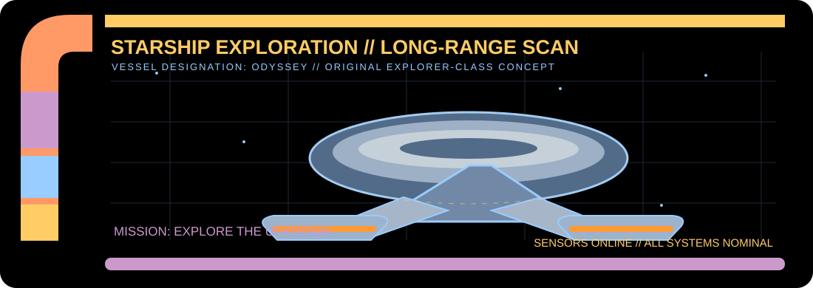
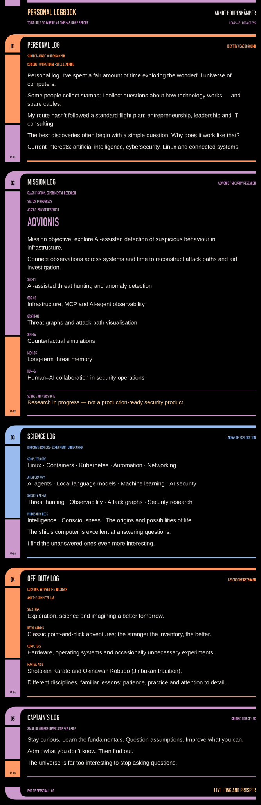

<picture>
  <source media="(max-width: 900px)" srcset="https://raw.githubusercontent.com/arndthb/arndthb/8080c3ab9412328f1f3abbb9c029272043ce6155/assets/lcars-starship-mobile.svg">
  
</picture>
<picture>
  <source media="(max-width: 900px)" srcset="https://raw.githubusercontent.com/arndthb/arndthb/702708a2f7ad8f8e9c82d3b44d8b230d5962a8f0/assets/lcars-logbook-mobile.svg">
  
</picture>
<a href="https://github.com/arndthb/m3-devops">
  <picture>
    <source media="(max-width: 900px)" srcset="https://raw.githubusercontent.com/arndthb/arndthb/8080c3ab9412328f1f3abbb9c029272043ce6155/assets/lcars-aqvionis-link-mobile.svg">
    
  </picture>
</a>

