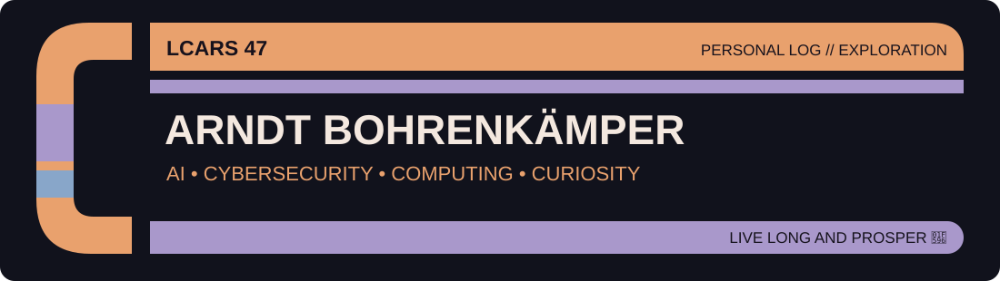
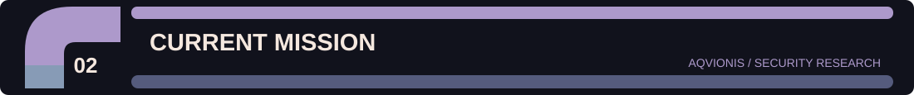
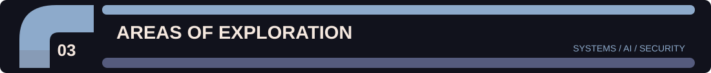
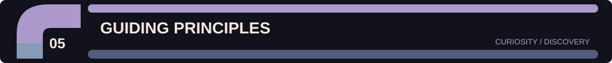

### 🖖 Welcome aboard

*To boldly go where no one has gone before.*

Hello there! I'm **Arndt** — a lifelong computer nerd, technology enthusiast, Trekkie and curious explorer of all things digital.

I love understanding **how things work**, questioning why they're done a certain way and exploring whether there's a better approach. My journey has taken me through entrepreneurship, business leadership and IT consulting — and I'm still learning every day.

I'm particularly interested in artificial intelligence, cybersecurity, Linux, computing and the possibilities that emerge when different technologies meet.

### 🛡️ [AQVIONIS](https://github.com/arndthb/AQVIONIS)

An experimental research and development project exploring **AI-assisted threat detection and infrastructure security**.

Areas of exploration include:

- AI-assisted threat hunting and anomaly detection
- Infrastructure, MCP and agent observability
- Threat graphs and attack-path visualisation
- Counterfactual simulations and long-term threat memory
- Human–AI collaboration in security operations

*An evolving research project, not a claim of production-ready detection capabilities.*

**Computing & infrastructure:** Linux · Containers · Kubernetes · Automation · Networking

**Artificial intelligence:** AI agents · Local language models · Machine learning · AI security

**Cybersecurity:** Threat hunting · Observability · Attack graphs · Security research

**The big questions:** What is intelligence? What is consciousness? Could artificial systems ever develop something resembling either?

- 🖖 **Star Trek:** Exploration, science, technology and imagining what might be possible.
- 🕹️ **Retro gaming:** Especially classic point-and-click adventures. Sometimes the solution really is to try every item in your inventory.
- 💻 **Computer & technology nerd:** Hardware, software, operating systems and the occasional wonderfully unnecessary experiment.
- 🥋 **Traditional martial arts:** Shotokan Karate and Okinawan Kobudō, including the Jinbukan tradition founded by Katsuyoshi Kanei.

Stay curious. Understand the fundamentals. Challenge assumptions. Keep learning. Explore the unknown.

**🖖 LIVE LONG AND PROSPER**

*End transmission.*

